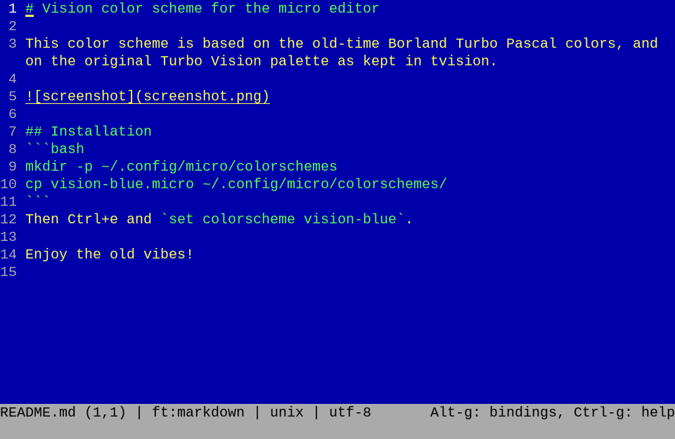

# Vision color scheme for the micro editor

This color scheme is based on the old-time Borland Turbo Pascal colors, and on the original Turbo Vision palette as kept in tvision.



## Installation
```bash
mkdir -p ~/.config/micro/colorschemes
cp vision-blue.micro ~/.config/micro/colorschemes/
```
Then Ctrl+e and `set colorscheme vision-blue`.

Enjoy the old vibes!
